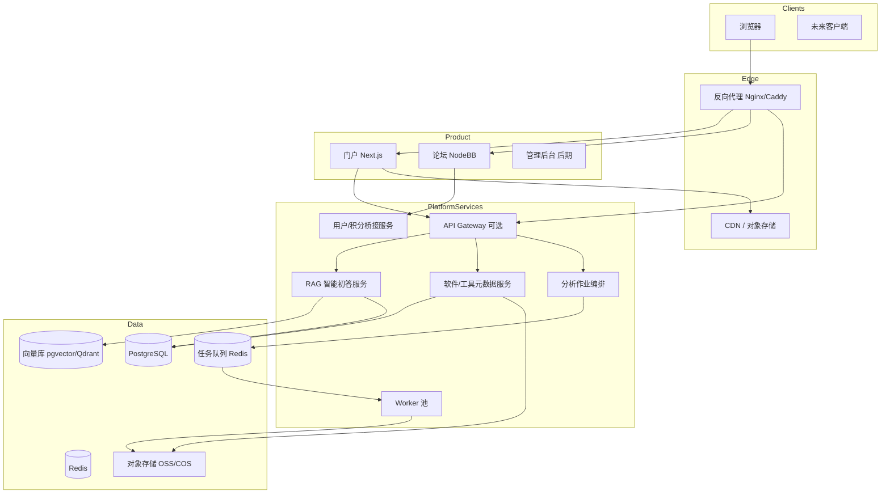
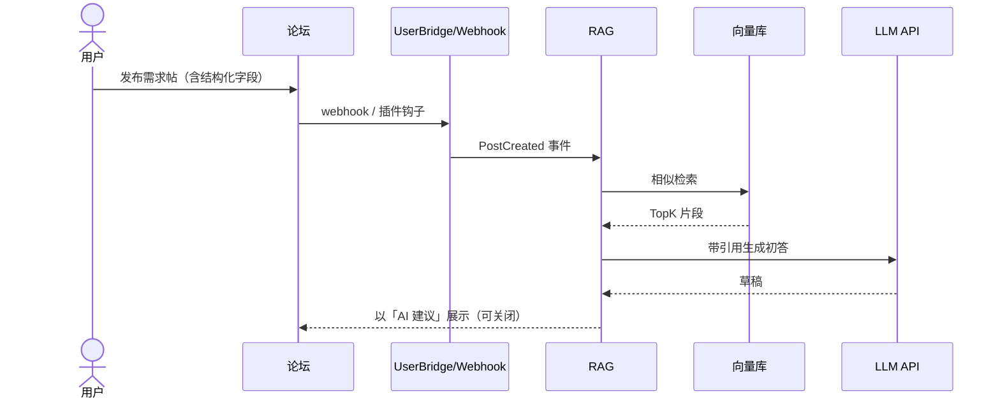
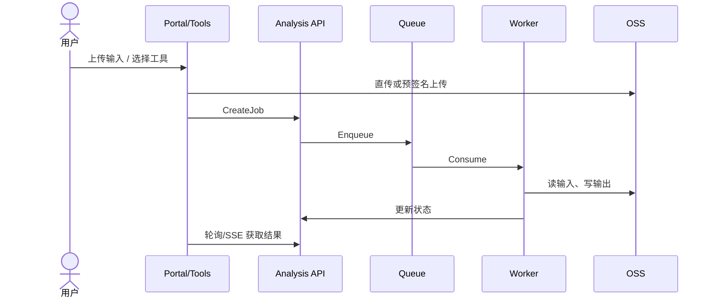

# 02 · 系统架构

**状态：** Accepted  
**版本：** v0.1

## 1. 架构原则

1. **社区为核**：论坛是内容与用户关系的主系统  
2. **服务解耦**：门户、论坛、RAG、分析各自独立部署、独立扩缩容  
3. **API 优先**：跨系统交互经明确契约；禁止隐式读写对方数据库（论坛除外可只读副本策略需 ADR）  
4. **同步轻、异步重**：发帖初答可同步超时降级；分析作业必须异步队列  
5. **可贡献**：工具以容器/脚本包接入，核心仓库保持精简  

## 2. 逻辑架构



## 3. 部署拓扑（推荐）

### 3.1 MVP：单机或「国内主站 + 轻量 PaaS」

```text
[国内 VPS]
  ├─ Caddy/Nginx
  ├─ Forum
  ├─ PostgreSQL + Redis
  ├─ Portal（或放 Zeabur）
  └─ rag-service（LLM 走外部 API）

[对象存储]
  └─ 附件 / 头像 / 分析 IO（后期）
```

### 3.2 成长期：业务与算力分离

| 节点 | 承载 |
|------|------|
| 业务机（国内） | 论坛、门户反代、PG、Redis、元数据 API |
| 算力机（国内或 Hetzner） | RAG 重检索、分析 Worker |
| GPU（按需） | 自托管模型 / 深度学习推理（非 MVP） |

详见 [基础设施与部署](./08-infrastructure.md)。

## 4. 子系统边界

| 子系统 | 职责 | 非职责 |
|--------|------|--------|
| Portal | 品牌、导流、聚合展示 | 不实现完整发帖逻辑 |
| Forum | 账号、发帖、回复、版块、基础搜索（NodeBB） | 不做重分析、不做向量检索主逻辑 |
| UserBridge | SSO/积分同步、结构化字段扩展 | 不替代论坛权限模型 |
| RAG | 相似帖、初答草稿、知识入库流水线 | 不直接写论坛正式回复（除非显式开关+审核） |
| ToolHub | 工具卡、环境模板元数据 | 不执行任意用户代码（执行走 Analysis） |
| Analysis | 作业提交、队列、结果落 OSS | 不提供开放 shell |

## 5. 关键数据流

### 5.1 发帖智能初答



### 5.2 在线分析作业



## 6. 域名与路由

| 主机 | 路由到 |
|------|--------|
| `keyantong.com` | Portal |
| `bbs.keyantong.com` | Forum |
| `api.keyantong.com` | Gateway / 各服务反向代理 |
| `tools.keyantong.com` | 分析与工具前端（成长期） |

Cookie / SSO 跨子域策略见 [安全与合规](./11-security.md)。

## 7. 可靠性目标（规划）

| 级别 | 目标 |
|------|------|
| MVP | 论坛可用性优先；RAG 失败必须静默降级，不影响发帖 |
| 成长期 | 核心 API 月可用性 ≥ 99.5%；分析任务可重试 |
| 扩展期 | 分服务 SLO；关键路径熔断与限流 |

## 8. 演进策略

```text
Phase 0  文档 + 仓库骨架
Phase 1  Forum + Portal + 基础积分
Phase 2  RAG 初答（API LLM）
Phase 3  ToolHub
Phase 4  Analysis Workers
Phase 5  贡献包市场 + SSO 统一
```

禁止在 Phase 1 引入：多集群编排、服务网格、自研论坛引擎。
