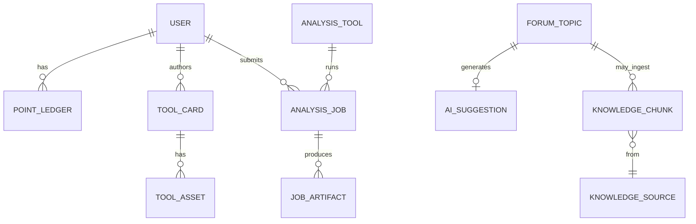

# 05 · 数据模型

**状态：** Accepted  
**版本：** v0.1

> 论坛内部表结构遵循上游（Discourse/NodeBB），本节描述 **自研库** 与 **桥接概念模型**。自研服务统一使用 PostgreSQL schema `kt`（keyantong）。

## 1. 概念 ER

## 2. 用户与积分

### 2.1 `kt.users`（桥接表）

| 字段 | 类型 | 说明 |
|------|------|------|
| id | uuid PK | 自研用户 ID |
| forum_user_id | text UNIQUE | 论坛侧 ID |
| display_name | text | 展示名 |
| email_hash | text | 可选，隐私哈希 |
| reputation | int | 冗余缓存 |
| points_balance | int | 积分余额 |
| role | text | `user`/`mod`/`admin` |
| created_at | timestamptz | |
| updated_at | timestamptz | |

### 2.2 `kt.point_ledger`

| 字段 | 类型 | 说明 |
|------|------|------|
| id | bigserial | |
| user_id | uuid FK | |
| delta | int | 可正可负 |
| reason | text | `accept_answer` 等 |
| ref_type | text | `topic`/`post`/`tool` |
| ref_id | text | |
| created_at | timestamptz | |

**必须**只追加、不改历史行；余额由事务内更新 `users.points_balance`。

## 3. 论坛事件与 AI

### 3.1 `kt.forum_topics_mirror`（可选瘦镜像）

用于检索与运营，不替代论坛：

| 字段 | 类型 | 说明 |
|------|------|------|
| forum_topic_id | text PK | |
| category | text | |
| title | text | |
| tags | text[] | |
| structured | jsonb | 结构化发帖字段 |
| accepted_post_id | text | |
| url | text | |
| ingested | bool | 是否已入库 |
| updated_at | timestamptz | |

### 3.2 `kt.ai_suggestions`

| 字段 | 类型 | 说明 |
|------|------|------|
| id | uuid PK | |
| forum_topic_id | text | |
| similar_refs | jsonb | TopK 链接 |
| draft_markdown | text | 初答 |
| model | text | |
| latency_ms | int | |
| status | text | `ok`/`timeout`/`error`/`disabled` |
| created_at | timestamptz | |

## 4. 知识库

### 4.1 `kt.knowledge_sources`

| 字段 | 类型 | 说明 |
|------|------|------|
| id | uuid PK | |
| source_type | text | `forum_accepted`/`faq`/`doc` |
| source_uri | text | |
| license | text | |
| reviewer_id | uuid | |
| status | text | `pending`/`approved`/`rejected` |
| created_at | timestamptz | |

### 4.2 `kt.knowledge_chunks`

| 字段 | 类型 | 说明 |
|------|------|------|
| id | uuid PK | |
| source_id | uuid FK | |
| chunk_index | int | |
| content | text | |
| metadata | jsonb | 软件名、物种等 |
| embedding | vector | pgvector；或外置 Qdrant id |
| token_count | int | |
| created_at | timestamptz | |

索引建议：`ivfflat` / `hnsw`（数据量上来后调参）。

## 5. 软件模块

### 5.1 `kt.tool_cards`

| 字段 | 类型 | 说明 |
|------|------|------|
| id | text PK | slug |
| name | text | |
| summary | text | |
| categories | text[] | |
| body_md | text | |
| install_spec | jsonb | conda/docker 等 |
| author_id | uuid | |
| status | text | `draft`/`published` |
| created_at / updated_at | timestamptz | |

### 5.2 `kt.tool_assets`

对象存储路径与校验和：`environment.yml`、`compose.yml`、截图等。

## 6. 在线分析

### 6.1 `kt.analysis_tools`

| 字段 | 类型 | 说明 |
|------|------|------|
| id | text PK | |
| name | text | |
| image | text | OCI 镜像 |
| openapi_url | text | |
| cpu_limit | numeric | |
| mem_mb | int | |
| timeout_sec | int | |
| enabled | bool | |

### 6.2 `kt.analysis_jobs`

| 字段 | 类型 | 说明 |
|------|------|------|
| id | uuid PK | |
| tool_id | text FK | |
| user_id | uuid FK | |
| status | text | `queued`/`running`/`succeeded`/`failed`/`cancelled` |
| input_uri | text | OSS |
| params | jsonb | |
| error_message | text | |
| created_at / started_at / finished_at | timestamptz | |

### 6.3 `kt.job_artifacts`

| 字段 | 类型 | 说明 |
|------|------|------|
| id | uuid PK | |
| job_id | uuid FK | |
| kind | text | `log`/`result`/`preview` |
| uri | text | |
| content_type | text | |
| size_bytes | bigint | |

## 7. 数据所有权

| 数据 | 权威源 |
|------|--------|
| 帖子正文、回复、权限 | 论坛库 |
| 积分账本、工具卡、Job | 自研 PG |
| 向量 | 自研 Vec |
| 大文件 | OSS |

**禁止**自研服务直接 `UPDATE` 论坛业务表；集成用官方 API/插件。

## 8. 迁移与备份

- 自研库：Flyway / Alembic / golang-migrate（团队择一）  
- 每日逻辑备份 PG；OSS 版本控制或跨区域副本（成长期）  
- 论坛按上游备份文档执行  
