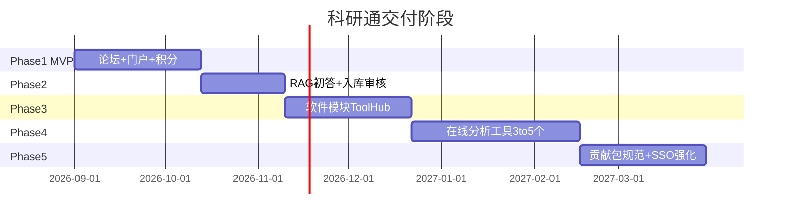

# 10 · MVP 与路线图

**状态：** Accepted  
**版本：** v0.1

## 1. MVP 一句话

> **可访问的品牌门户 + 可运营的分类互助论坛（积分采纳）+ 可降级的相似帖/AI 初答**，用 4–6 周验证内容飞轮。

**明确选择：论坛优先，RAG 轻量并行；不做独立聊天机器人，不做完整在线分析。**

## 2. MVP 范围

### 2.1 必须有（Must）

| 项 | 验收标准 |
|----|----------|
| 域名与 HTTPS | 门户与论坛可公网访问 |
| 论坛 6 个版块 | 分类清晰，可发帖回复 |
| 积分 + 采纳 | 采纳后积分入账可查 |
| 结构化标签/字段（最小） | 至少软件名或版块标签可用 |
| 门户首页 | 定位、CTA、热门帖入口 |
| 社区规约与合规页 | 文献互助合法途径声明 |
| 种子内容 | ≥ 20 篇优质种子帖 |
| 种子用户 | 邀请 10–20 人试用 |

### 2.2 应该有（Should）

| 项 | 验收标准 |
|----|----------|
| 相似帖推荐 | Top5 可点开 |
| AI 初答草稿 | 总开关；失败不影响发帖 |
| Webhook 桥接 | 事件可观测、可重试 |
| 基础监控 | 存活探测 + 磁盘告警 |
| 备份 | PG/论坛上传可恢复 |

### 2.3 可以没有（Won’t / MVP 禁止）

- 完整 ToolHub 市场  
- 在线分析 Job 系统  
- 自托管 LLM / GPU  
- 现金提现、复杂商城  
- 移动 App  
- 自研论坛引擎  
- K8s  

## 3. 阶段路线图

日期为规划示意，以实际启动日平移。

## 4. 量化成功指标（MVP 后 30–60 天）

| 指标 | 目标 |
|------|------|
| 月发帖用户 | ≥ 50 |
| 帖子首次回复中位时间 | < 24h |
| 采纳率 | ≥ 30% |
| AI 草稿被用户采纳或编辑使用率 | ≥ 20%（若开启） |
| 搜索/自然流量占新访 | ≥ 20%（视 SEO 周期可放宽） |
| 严重合规事件 | 0 |

未达指标时：优先运营与内容，不优先加分析平台。

## 5. 里程碑检查清单

### M0 · 文档与决策

- [x] 开发者文档基线 v0.1  
- [x] 开源工程骨架（治理 / Monorepo / Compose / CI）  
- [x] 论坛引擎拍板：**NodeBB**（ADR-001）  
- [x] 主许可：**Apache-2.0**（ADR-006）  
- [x] Monorepo + 分层贡献（ADR-007）  
- [ ] 域名/备案状态确认  
- [ ] 云厂商账号与预算上限  

### M1 · 论坛可运营

- [ ] 生产论坛上线  
- [ ] 版块与规约  
- [ ] 备份脚本  
- [ ] 种子帖与版主  

### M2 · 门户与品牌

- [ ] Portal 上线并链到论坛  
- [ ] 基础设计与移动端可用  

### M3 · 智能初答

- [ ] Webhook → suggest  
- [ ] 评测集 v0  
- [ ] 费用与开关告警  

### M4 · 成长期入口

- [ ] ToolHub RFC  
- [ ] 首个分析工具设计文档  

## 6. 人员角色（最小）

| 角色 | 职责 |
|------|------|
| 产品/负责人 | 边界、优先级、运营节奏 |
| 全栈/后端 | 桥接、RAG、部署 |
| 前端 | 门户 |
| 版主 | 内容质量与合规 |
| 顾问贡献者 | 种子回答与工具卡 |

一人团队时：按 M1 → M2 → M3 串行，勿并行开分析。

## 7. 风险与缓解

| 风险 | 缓解 |
|------|------|
| 冷启动无帖 | 种子内容 + 定向邀请实验室群 |
| Discourse 内存不足 | 选 8G 或改 NodeBB |
| AI 胡编伤害信任 | 强提示+引用+默认不自动发帖+抽检 |
| 版权投诉 | 规约、举报、快速下架流程 |
| 范围蔓延 | 本文件 Won’t 清单，变更走评审 |
