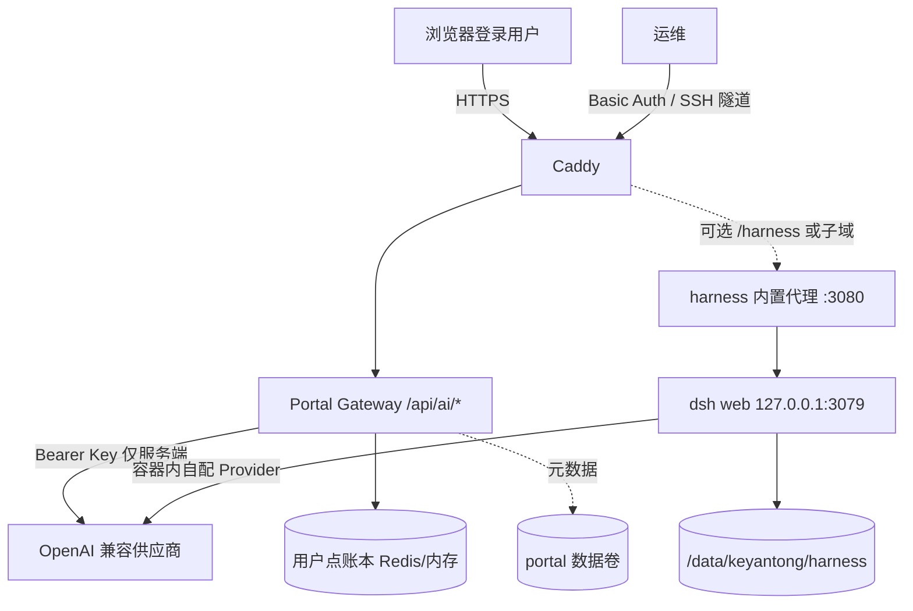

# 22 · LLM 网关与 DeepSeek Harness 总管

**状态：** Accepted（MVP）  
**版本：** v0.1  
**范围：** 门户业务 LLM Gateway + 可选 DeepSeek Harness（`dsh web`）智能化总管；额度双账本与模型档位匹配。  
**参考：** 蔬叶甄选《13-LLM接口开发设计》原则；[deepseek-ai/deepseek-harness](https://github.com/deepseek-ai/deepseek-harness)（developer preview，务必读 SAFETY.md）。

---

## 1. 为什么拆成两层

| 层 | 名称 | 谁用 | 做什么 | 不做什么 |
|----|------|------|--------|----------|
| A | **业务 LLM Gateway** | 门户登录用户（校园试用/永久会员） | OpenAI 兼容 `chat/completions`；FAQ/工具说明/RAG 草稿；JSON 或纯文本；按用户计点 | 不跑 Agent、不执行 shell、不碰 NCBI 大文件、不把 Key 给浏览器 |
| B | **DeepSeek Harness（dsh）** | 运维 / 可信运营（Basic Auth 或本机隧道） | 插件化 Agent 总管：编排、工具、会话；`npx @deepseek-ai/dsh web` | **不得**裸奔公网；不挂载密钥目录；不自动挂载 `/data/keyantong/portal` 用户库 |

蔬叶甄选原则落在 Gateway：

1. 协议只认 OpenAI 兼容  
2. 业务不直接拿 Key  
3. 先事实后模型（门户侧先组工具卡/检索片段再调模型）  
4. 可校验输出（可选 `json_object`）  
5. 产品线隔离（C 端助手 vs 运维 Harness 配置/密钥/配额分开）  
6. 写操作不交给模型（Gateway 无写工具；Harness 仅在隔离容器内、人工看过再开高权限插件）  
7. 脱敏进上下文  
8. 失败可降级（未配 Key / 超时 → 明确中文错误，页面不卡死）

Harness 是「智能化总管」实验层：能力强、风险也高（可执行模型生成命令、加载第三方插件）。生产默认 **profile 关闭**；开启后仍须 Basic Auth + 最小权限容器。



---

## 2. 业务 LLM Gateway（门户）

### 2.1 环境变量（只进 `infra/.env`，永不进 Git / 浏览器）

| 变量 | 含义 | 示例 |
|------|------|------|
| `LLM_BASE_URL` | OpenAI 兼容根路径 | `https://api.deepseek.com/v1` 或硅基流动 `https://api.siliconflow.cn/v1` |
| `LLM_API_KEY` | 供应商 Key | `sk-...` |
| `LLM_MODEL` | 默认档 | `deepseek-chat` |
| `LLM_MODEL_FAST` | 快档（FAQ/短答） | `deepseek-chat` |
| `LLM_MODEL_REASONING` | 推理档 | `deepseek-reasoner` |
| `LLM_DAILY_TOKEN_BUDGET` | 每用户每日 **计费 token** 上限（折算前） | `200000` |
| `LLM_DAILY_CALL_BUDGET` | 每用户每日调用次数 | `80` |
| `LLM_TIMEOUT_MS` | 单次超时 | `45000` |
| `LLM_ALLOW_ANY_MODEL` | `1` 关闭前缀白名单（默认关） | `0` |

代码：`apps/portal/src/lib/llm/`；路由：

| 方法 | 路径 | 鉴权 | 说明 |
|------|------|------|------|
| `GET` | `/api/ai/status` | 登录即可 | 是否配置、额度余量；**永不**回传 Key |
| `POST` | `/api/ai/chat` | 登录 + `isEntitled` | 场景化聊天；限流 + 日配额 |

### 2.2 调用约定

```
POST {LLM_BASE_URL}/chat/completions
Authorization: Bearer {LLM_API_KEY}

messages: [
  { role: "system", content: "<固定系统提示，禁止塞用户原文>" },
  { role: "user", content: "{\"untrusted_user_text\":\"...\",\"facts\":[...]}" }
]
```

- 温度偏低（0.2）；`max_tokens` 按场景封顶  
- 用户原文只进 `user` 消息的 JSON 字段 `untrusted_user_text`  
- 输出经消毒（去 HTML/控制符，扫 `sk-` / 私钥形态）  
- 模型名必须过前缀白名单（除非 `LLM_ALLOW_ANY_MODEL=1`）

### 2.3 与 RAG / NCBI / 大文件边界

- Gateway **不接收** FASTQ/表达矩阵正文；只接受短文本（默认 ≤4k 字）与结构化 `facts`  
- NCBI 上传仍按 [19](./19-ncbi-local-upload-architecture.md) **本机直传**；模型不得生成「把数据传到科研通服务器再 ascp」的流程  
- 上游分析 ≤80GB 走 [21](./21-rnaseq-upstream-worker.md) worker；模型只可解释**已脱敏的任务元数据**（job id、状态、报错摘要），不可要求用户粘贴测序原文  

---

## 3. 额度双账本与模型匹配

### 3.1 两个账本

| 账本 | 单位 | 用途 | 谁看见 |
|------|------|------|--------|
| **用户点** | point | 产品侧「今日还能问几次/还剩多少点」 | 用户 `/api/ai/status` |
| **供应商成本** | raw token（prompt+completion）+ 可选 CNY 估算 | 运维对账、防止账单打爆 | 仅服务端日志 / 日后 admin；**不对 C 端暴露 Key 与单价明细到可逆推 Key 的程度** |

同一笔调用：

1. 供应商返回 `usage.prompt_tokens` / `completion_tokens`（合计 `T`）  
2. 按模型档位取系数 `k`  
3. **用户扣点** `points = ceil(T × k)`  
4. 供应商账本累加 `T`（及按公开价目估算的成本，价目表可配置，默认仅记 token）

Redis 优先（`REDIS_URL`）；不可用则进程内存（单节点 MVP）。键示例：

- `kt:ai:pts:{userId}:{YYYYMMDD}` — 当日已用点数  
- `kt:ai:calls:{userId}:{YYYYMMDD}` — 当日调用次数  
- `kt:ai:sup:{YYYYMMDD}` — 全站供应商 token 合计（粗粒度）

### 3.2 点数公式

```
points = ceil( (prompt_tokens + completion_tokens) × model_coefficient )
```

若供应商未返回 usage，则用启发式：`ceil((len(prompt)+len(completion))/4 × k)`，并标记 `usageEstimated: true`。

### 3.3 模型档位与系数（默认表，可在代码 `models.ts` 调整）

| 档位 | 环境变量 | 建议模型（DeepSeek 示例） | 系数 `k` | 适用 |
|------|----------|---------------------------|----------|------|
| **fast** | `LLM_MODEL_FAST` | `deepseek-chat` | **1.0** | 寒暄、短 FAQ、标签分类 |
| **default** | `LLM_MODEL` | `deepseek-chat` | **1.5** | 工具说明、社区检索摘要、RAG 草稿 |
| **reasoning** | `LLM_MODEL_REASONING` | `deepseek-reasoner` | **3.0** | 多步排错、实验设计推敲（严格日封顶） |

硅基流动等兼容供应商：把模型 id 换成对应聊天模型即可，**系数仍按档位不按厂商名**，避免运营误选 embedding。

### 3.4 场景 → 档位（Gateway）

| `scene` | 档位 | max_tokens | 日调用额外约束 |
|---------|------|------------|----------------|
| `faq` / `chat` | fast | 600 | 计入总次数 |
| `tool_help` / `rag_draft` | default | 1200 | 计入总次数 |
| `deep_troubleshoot` | reasoning | 2000 | 另计；建议每日 ≤10 次（代码内软上限） |
| 未识别 | default | 800 | — |

请求体示例：

```json
{
  "scene": "tool_help",
  "message": "DESeq2 padj 全是 NA 怎么办",
  "facts": ["species=human", "engine=pydeseq2"],
  "json": false
}
```

### 3.5 Harness 会话额度

Harness **不走**门户 `/api/ai/chat` 点数（它在容器内直连供应商），但必须单独治理：

| 控制 | 建议默认 | 说明 |
|------|----------|------|
| 会话 token 封顶 | 200k / session | 在 dsh / 供应商侧配置；超则停 |
| 日供应商封顶 | 运维自查 DeepSeek/硅基账单 | 门户 `kt:ai:sup:*` 可作旁路观测 |
| 并发会话 | 1～2 | 单机 8G 场景勿开多 Agent 狂飙 |
| 访问 | Basic Auth 或 `127.0.0.1` 隧道 | 禁止匿名公网 |

将 Harness 用量「折算进用户点」是后期账本；MVP 把 Harness 定位为**站务总管**，不是 C 端按次计费产品。

### 3.6 配额用尽与降级

- 日点数或次数用尽 → `429`，中文说明明日重置（按 **Asia/Shanghai** 自然日）  
- 未配置 `LLM_API_KEY` → `503`「助手暂未配置」  
- 供应商 5xx / 超时 → `502`/`504`，不把厂商 HTML 回传  
- Redis 故障：Gateway **fail-open 到内存**（与 C 端客服 fail-closed 不同：科研通 MVP 先保可用；上规模后可改 fail-closed）

---

## 4. DeepSeek Harness 部署

### 4.1 安全硬约束（SAFETY.md）

- developer preview，**未做安全审计**；可执行模型生成代码/命令  
- **必须**容器 + 非 root + 只挂载 `/data/keyantong/harness`  
- **禁止**挂载：`infra/.env`、`/home/box/.secrets`、`/data/keyantong/portal/users.json`、Postgres 数据目录  
- **禁止**对公网映射无鉴权端口；官方拒绝 `--host 0.0.0.0`，本镜像用环回 dsh + 容器内代理  

### 4.2 Compose profile `harness`

```bash
cd /opt/keyantong
docker compose -f infra/docker-compose.prod.yml --env-file infra/.env \
  --profile harness up -d --build
```

- 数据：`KEYANTONG_DATA_ROOT/harness` → 容器 `/data/harness`（`DSH_HOME`）  
- 宿主机目录属主须为容器用户：`sudo chown -R 10001:10001 /data/keyantong/harness`  
- 宿主机仅 `127.0.0.1:3080:3080`（默认）  
- 可选 Caddy：先配 DNS，再合并 `infra/caddy/Caddyfile.harness.example`（Basic Auth：`HARNESS_BASIC_USER` / `HARNESS_BASIC_HASH`）；默认主 Caddyfile **不含** harness 子域，以免无 DNS 时 ACME 影响主站  

### 4.3 注入供应商 Key（Harness 专用，与门户可分开）

1. **推荐：** 进入 Web UI 后在 Harness 设置里配置 Provider（密钥落在 `DSH_HOME` 卷，勿提交 Git）  
2. **可选环境变量占位：** `DSH_LLM_API_KEY` / `DSH_LLM_BASE_URL`（若当前 dsh 版本支持环境注入；不支持则以 UI 为准）  
3. 门户 `LLM_API_KEY` **不要**自动挂进 Harness 容器，避免一套 Key 被 Agent 工具链误用放大账单  

首次可无 Key 起容器（Web UI 能开）；聊天会失败直到注入 Key——这是预期。

### 4.4 访问方式

| 方式 | 命令 / URL | 适用 |
|------|------------|------|
| SSH 隧道 | `ssh -L 3080:127.0.0.1:3080 ubuntu@<服务器>` →浏览器 `http://127.0.0.1:3080` | 默认推荐 |
| 子域 + Basic Auth | `https://harness.keyantong.online`（需 DNS A 记录） | 远程运维 |
| 路径反代 | 易与 dsh 绝对路径冲突，**不推荐**作主方案 | — |

---

## 5. 迁移

Harness 数据已纳入 `/data/keyantong/harness`。备份脚本应打包该目录（与 portal/redis/caddy/rnaseq 并列）。迁机：

1. `backup.sh`  
2. 新机 Docker + 同步 `/opt/keyantong` + restore  
3. `--profile harness` 按需再开  
4. 在新机 Harness UI 确认 Provider Key 仍可读（同卷迁移）或重新录入  

详见 [20](./20-production-deploy-migrate.md)。

---

## 6. 验收清单

Gateway

- [ ] 未登录 `POST /api/ai/chat` → 401  
- [ ] 未 entitled → 403  
- [ ] `GET /api/ai/status` 无 `apiKey` / `sk-` 字段  
- [ ] 日配额耗尽 → 429  
- [ ] 用户原文未出现在 system 消息  

Harness

- [ ] 未带 profile 时无 harness 容器  
- [ ] 3080 不对 `0.0.0.0` 公网暴露（仅 127.0.0.1 或经 Basic Auth）  
- [ ] 容器只读挂载无 `.env` / secrets  

---

## 7. 代码与配置索引

| 项 | 路径 |
|----|------|
| 设计本文 | `docs/22-llm-gateway-and-harness.md` |
| Gateway 库 | `apps/portal/src/lib/llm/` |
| API | `apps/portal/src/app/api/ai/` |
| Compose | `infra/docker-compose.prod.yml` profile `harness` |
| 镜像 | `infra/harness/Dockerfile` + `proxy.mjs` |
| 环境模板 | `infra/.env.example`、`apps/portal/.env.example` |

---

## 8. 生产配置快照（硅基流动 · 2026-11）

| 项 | 值 |
|----|-----|
| `LLM_BASE_URL` | `https://api.siliconflow.cn/v1` |
| `LLM_MODEL_FAST` | `Qwen/Qwen2.5-7B-Instruct` |
| `LLM_MODEL` | `deepseek-ai/DeepSeek-V3` |
| `LLM_MODEL_REASONING` | `deepseek-ai/DeepSeek-R1` |
| Key 存放 | 仅 `infra/.env` / 保险库；**永不**进 Git、镜像层、浏览器 |
| Harness 镜像 | 默认 `smanx/deepseek-harness:latest`（内置环回代理）；数据卷 `/data/keyantong/harness` |
| 访问 Harness | `ssh -L 3080:127.0.0.1:3080 ubuntu@SERVER` → `http://127.0.0.1:3080` |

点数公式仍为 `points = ceil(tokens × k)`，`k∈{1.0,1.5,3.0}` 对应 fast/default/reasoning。

若 API Key 曾出现在聊天或工单中，**务必在硅基流动控制台轮换**后再写入 `.env`。

## 9. 专属科研角色（2026-11-05）

根据用户要求新增独立的公共角色 SDK 适配层，使用同版本 Harness 引擎及按用户/角色隔离的 home，不共享运维 Web UI 或数据卷。公网门户只访问内部令牌 API。配置与限制见 [28](./28-research-commons.md) 及 ADR-010；现有运维 Harness 已部署不代表公共角色服务已部署。
