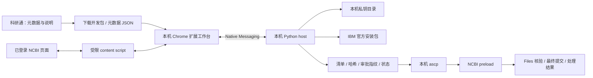

# 29 · NCBI SRA 本机自动化：流程、实现与验收

2026-11-05 · 开发预览。目标：在用户本机连接浏览器、安装环境、传输与 NCBI 提交；门户保留控制面，测序文件不经过科研通。

## 现场核对与官方依据

本次只读检查了用户已登录的 Chrome SRA 首页与展开后的 Aspera 说明。未创建新的提交、下载真实私钥、安装 IBM 软件或上传研究数据。账户、实际 preload 目录和提交记录未写入源代码。

- 当前首页 `https://submit.ncbi.nlm.nih.gov/subs/sra/` 的 “Upload via Aspera command line or FTP” → “Aspera command line instructions” 已提供私钥链接 `/preload/aspera_key/` 和账户专属命令。获取凭证可以先于完整填写项目。
- 私钥及上传目录可能轮换，应读取当前账户页面；不能把示例目录固定进技能、网页或命令。
- 远程用户固定 `subasp@upload.ncbi.nlm.nih.gov`，NCBI 登录邮箱只是身份标识。
- 必须使用账户目录下的独立 submission 子目录。直接写账户根目录或额外嵌套层级会影响 Files 选择。
- 页面提示：文件上传后至少约 10 分钟才能在 Files 选择；创建的上传文件夹若未完成提交，30 天后可能被清理。应以当前页面为准。
- IBM 官方下载页现同时列出 Aspera Client 与 Connect。此实现只使用官方页面明确链接的 Connect 安装包；不推断两者 CLI 参数完全兼容。

依据：[NCBI 文件上传](https://www.ncbi.nlm.nih.gov/sra/docs/submitfiles/)、[NCBI 提交向导](https://www.ncbi.nlm.nih.gov/sra/docs/submitportal/)、[IBM 官方下载](https://www.ibm.com/products/aspera/downloads)、[Chrome Native Messaging](https://developer.chrome.com/docs/extensions/develop/concepts/native-messaging)。真实已登录页面优先于历史截图。

## 交互设计

用户从科研通 NCBI 页面下载开发包，在本机安装 Chrome 扩展与 native host。首次安装需要用户授权；后续由扩展打开本机工作台。

1. **研究材料**：项目/样本/文库元数据、本地数据目录、文件与样本映射、已有 BioProject/BioSample、公开日期。字段缺失由用户补充；不由模型编造生物学属性。
2. **账户连接**：选择已经登录的 SRA 标签页。用户在 NCBI 完成登录/MFA，扩展不读取密码或 cookies，也不把会话导出到云端。
3. **上传配置**：从当前账户页面识别命令与账户目录，浏览器以当前登录态下载私钥，native host 复制到本机私有目录并设置权限。下载到登录 HTML 或异常文件时拒绝导入。
4. **环境准备**：本机识别 OS/CPU、PATH 与常见 Aspera 路径。缺失时从 IBM 当前官方页面定位安装包，验证下载地址、大小及平台签名，打开系统安装器。用户完成许可、UAC/Gatekeeper 等本机确认，再检测 ascp。
5. **文件核验**：专用目录只含待上传清单中的普通文件；拒绝子目录、符号链接、路径越界、空文件、额外文件与目录内私钥。流式计算 MD5、SHA-256、大小和修改时间。
6. **传输确认**：展示确切文件、总字节数、账户与远端子目录。确认摘要绑定目标、参数、元数据与文件哈希；任何变化使原确认失效。
7. **本机传输**：传输任务独立于扩展页面生存，关闭网页不等于停止上传。直接 argv 调用 ascp，无 shell/eval；`-k1` 为部分传输恢复保留依据。同一任务禁止双启动。
8. **远端核验**：传输完成后进入 `awaiting_ncbi_files`，不冒充已提交。等待 Files 可见并检查同名目录、文件名、大小与 NCBI 提供的校验结果；本地 MD5 不代表已经得到远端 MD5 一致的证据。
9. **网页提交**：辅助填写 Submitter / General Info / Project / BioSample / SRA Metadata。当前版本只代填唯一精确匹配的可见字段，停下核对。未知页面、重复标签、多样本表格、radio/checkbox 与官方模板上传进入人工处理；不盲点 Continue 或 Submit。
10. **最终核对与处理**：核对账户、existing/new 项目样本、文件映射、公开日期、同意事项后，由用户在 NCBI 最终提交。记录实际 SUB 编号；继续区分 processing / rejected / processed / accessions，不从按钮点击推断成功。

## 架构

Native host 无公开 TCP 监听、无任意命令接口，仅接受注册的扩展 origin。扩展只有 SRA 域名访问权限，网页 content script 不能直接调用本机操作；本机控制命令来自扩展自己的页面。浏览器截图、cookies、私钥和原始文件不进入 Harness/LLM。模型可以解释错误和提出方案，不负责认定传输或提交已完成。

## 状态与证据

| 状态 | 必须有的证据 | 后续 |
| --- | --- | --- |
| 账户待连接 | 当前 SRA 页面与登录标识 | 用户登录/MFA |
| 上传配置已取得 | 当前页面的官方目标、合法下载的本机私钥 | 本机环境检测 |
| awaiting_transfer_approval | 元数据校验、本机 dry-run、精确文件清单和哈希、目标与确认摘要 | 用户核对并同意 |
| transferring | 独占任务锁、原计划校验、ascp 进程与日志 | 等待退出/失败 |
| transfer_failed | 退出码、超时或本地文件变化记录 | 核对原任务后恢复，避免新建重复提交 |
| awaiting_ncbi_files | ascp exit 0，传输后本地文件一致 | 等 Files 可见并核对 |
| review_ready（下一阶段自动识别） | 远端文件/元数据一致，公开日期明确 | 用户最终确认 |
| submitted（下一阶段自动识别） | 实际 NCBI 回执/SUB | 跟踪处理 |
| processed/accessions（下一阶段自动识别） | NCBI 实际处理状态与 accession 文件 | 记录并归档 |

本地锁在正常退出时清理。系统强制断电后遗留锁需要先确认原进程已不存在，再人工清理，当前不会冒险自动重启未知状态的任务。重试保留相同文件夹/目标，文件变化应创建新确认计划。

## 安装与平台边界

| 平台 | 当前实现 | 尚需验收 |
| --- | --- | --- |
| macOS x86_64 | Python native host、官方 pkg 下载、pkgutil + Gatekeeper 检查、打开系统安装器 | 真机安装及传输 |
| macOS arm64 | 本机检测与既有 ascp 探测 | IBM ARM/兼容包确认；不静默安装 Rosetta |
| Windows x64 | 本机路径探测、官方 MSI 下载、Authenticode 检查、系统安装器、可构建 native EXE | Windows 打包、签名、权限及真实任务 |
| Linux x86_64 | Python host、官方包下载、既有 ascp 探测 | 官方校验信息与安装步骤核对，当前不自动执行 tar 包脚本 |
| 其他架构 | 明确报告未支持 | 厂商兼容性确认 |

下载后的 SHA-256 是本地完整性收据，不冒充 IBM 公布的可信摘要。Windows/macOS 启动安装前检查系统签名；Linux 在未有可信发布验证链前保留用户审核安装。

## 已交付代码

- `keyantong_ncbi/installer.py`：系统检测、官方安装包发现/下载、平台签名检查与安装界面。
- `keyantong_ncbi/workflow.py`：本地清单、哈希、审批指纹、任务与恢复基础、后台传输状态。
- `keyantong_ncbi/native_host.py`：Chrome 原生消息边界与允许的本地操作。
- `extension/`：选择 SRA 标签页、读取账户上传说明、下载私钥、创建/确认/启动任务、精确字段代填。
- `scripts/install_native_host.py` / `native_entry.py`：用户级注册与 Windows 打包入口。
- 修复原 runner 的 shell=True、文件目录过宽、命令空格、静默进程超时等问题。
- `skills/ncbi-local-upload/SKILL.md`：复用同一状态、权限和证据规则。

## 完整自动化上线门槛

1. 用用户明确指定的测试草稿与可公开测试数据，逐步采集当前 Portal 的 Submitter/Project/BioSample/SRA Metadata/Files/Overview 真实字段与校验行为；不拿生产提交试错。
2. 多样本 schema：BioSample package 的官方必填模板、每个实验到文件/样本的映射、现有 accession 复用、taxonomy 与仪器/文库词表。当前单样本门户表单不能自动扩充成多样本真值。
3. 每个网页步骤写独立适配器与页面变更检测，覆盖保存失败、会话过期、重复草稿、网络断开和重复点击。native host 只执行已审批本机操作。
4. 用真实 Aspera 验证断点恢复、带宽、防火墙/UDP、重试、远端目录可见性与失败码；加入可验证的取消与崩溃恢复，不能靠轮询页面状态强行判定成功。
5. 原生 host 与扩展签名发布，补齐 Windows/macOS/Linux 安装和卸载流程、升级回滚、供应链摘要；此仓库开发包不等于正式签名安装器。
6. 真实验收须贯穿上传、Files 核对、最终提交与 accession 取得。当前离线测试、浏览器只读观察和 UI 构建不能替代这一验收。

产品口径：提供尽可能自动的本机流程，在真实权限、安装许可、页面未知状态和最终提交处明确停下。开发预览不能宣传为已经无人值守完成全部 SRA 提交。

## 本轮验证记录

- NCBI Python 单元测试 16 项通过，覆盖原校验/runner、哈希确认失效、额外文件/目录内私钥拒绝、注入/越界、空格路径、静默超时、私钥误下载 HTML 拒绝、native 消息长度及 portable pyz 启动/origin 限制。
- 隔离 Chrome fixture 验证 content script 不读取密码、精确代填、重复/未知字段停下；未用真实 NCBI 草稿执行代填或 Submit。
- 门户 NCBI local-pack smoke、类型检查、生产构建与包含该页面的四档宽度布局回归通过。
- SDK bridge 通过 fake Harness 的鉴权、用户/角色目录隔离、持久会话恢复及清理测试；不冒充真实 Harness 部署已联通。
- 开发 ZIP 可重复生成、ZIP 完整性和 SHA-256 检查通过；归档不含运行时用户库、私钥或 `.env`。
- 未安装真实 IBM 软件、修改本机 Chrome 扩展权限、下载用户真实私钥、创建真实 SRA 草稿、上传或最终提交研究数据。真实跨系统安装、网络传输、Files 到 accession 的整体验收仍未完成。

## 浏览器免安装中转方案（设计，未开放）

用户通过科研通聊天选择或拖入 FASTQ。浏览器使用短期授权分片直传到专用私有暂存桶，门户只接收元数据和上传回执。分片可续传，按账号、任务和批次隔离。服务端复核文件大小、完整性、文件名与样本映射后，才进入明确确认的转交步骤。

优先验证 NCBI SRA 的 Amazon S3 / Google Cloud Storage 导入路径，使用真实受支持的存储提供商和限于本批文件的读取授权。现有 S3 兼容存储不能直接假定为 NCBI 支持的 Amazon S3。若改用服务器侧 Aspera，须单独验证 IBM 许可、NCBI 传输授权、目标目录和网络；科研通账号或浏览器 NCBI 登录都不会自动授权服务器发起传输。用户密码、浏览器会话和长期密钥不进入聊天或模型。

暂存采用独立配额、并发限制、失败续传、分片清理及保留期限，转交完成和 NCBI 最终提交分别记账。首轮用合成文件验证两段校验、跨账号拒绝、传输中断恢复和过期清理，再用获得授权的测试提交验证 NCBI 实际接收。参考 [NCBI SRA 提交流程](https://submit.ncbi.nlm.nih.gov/about/sra/) 与 [NCBI 文件上传](https://www.ncbi.nlm.nih.gov/sra/docs/submitfiles/)。

### 首期生产暂存

登录科研通后，在任务中选择 FASTQ 或拖入文件，核对名称后说“确认暂存”。上传中断可重选同批原文件并说“继续暂存”，也可用“查看暂存进度”。每账号 2 GiB、每批至多 100 个文件、24 小时可用。后台每小时清理超过 25 小时的暂存目录。原始 FASTQ 使用单独私有卷，不进入常规备份；任务数据库只记录清单和分片哈希。该部署为单机暂存，后续接入受支持的云桶后再启用 NCBI 转交。
